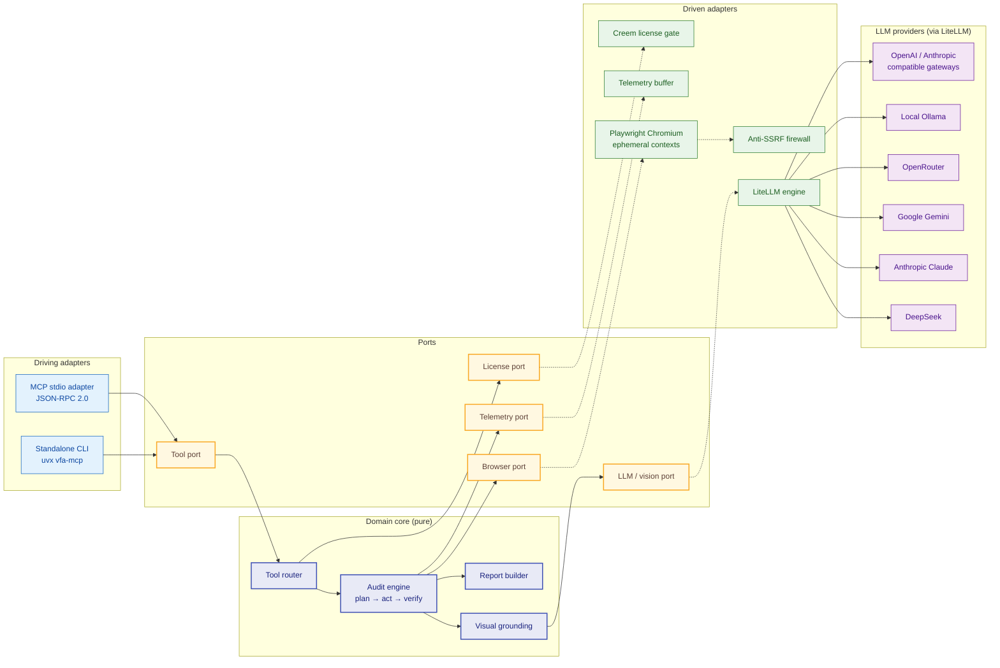

# VFA — Visual & Functional Web Auditor

**VFA** is an autonomous black-box web QA agent. It navigates real browsers, reasons about
what it sees, and reports functional defects, console errors and broken network calls —
without access to your source code, test IDs or internal APIs.

VFA ships as a **[Model Context Protocol (MCP)](https://modelcontextprotocol.io) server over
stdio**. Any MCP-capable client (Cursor, Claude Desktop, Roo Code, Cline, custom agents) can
hand it a URL or a natural-language user flow and receive a structured, machine-readable
audit report back.

```bash
# Zero-docker, zero-infrastructure: one command to run the server
uvx vfa-mcp
```

!!! info "Commercial license required"
    VFA is a commercial product distributed through Creem. A single-seat
    `VFA_LICENSE_KEY` is required to start the server. See
    [Quickstart & License](quickstart.md) for activation details.

## Key pillars

| Pillar | What it means in practice |
| --- | --- |
| **Native Zero-Docker** | Uses a locally installed Playwright Chromium — no containers, no remote browser farms, no extra services to operate. VFA runs wherever your MCP client runs, including locked-down corporate laptops. |
| **Universal LiteLLM Engine** | The reasoning layer is provider-agnostic through LiteLLM. DeepSeek, Anthropic, Google Gemini, OpenRouter, Azure, or a local Ollama instance — switch with one environment variable, no code changes. |
| **Active Visual Grounding** | VFA does not rely on brittle CSS/XPath selectors. It screenshots the live page, maps the DOM into an annotated snapshot, and grounds element interactions in what a human would actually see. |
| **1-Click Execution** | `uvx vfa-mcp` bootstraps the server with no clone, no virtualenv and no build step. PyPI distribution plus an ephemeral dependency cache keeps startup under a few seconds. |

## Architecture at a glance

VFA follows a **ports & adapters (hexagonal)** layout: the audit domain owns the rules, the
ports declare what the domain needs, and every side effect — transport, browser, model calls,
license validation — lives behind an adapter that can be swapped without touching the core.



Solid arrows are calls issued by the core towards a port; dashed arrows are dependency
inversions resolved at composition time, so the domain never imports an adapter. Every LLM call
is provider-agnostic because LiteLLM sits behind the same `LLM / vision port` regardless of the
model selected in [Environment Variables](configuration.md).

Every invocation spawns a short-lived `BrowserContext`, performs the audit, drains the
telemetry buffer and tears the context down. Nothing is persisted between runs unless you
explicitly enable the session pool.

## Security overview

Black-box auditing means pointing an autonomous agent at live web pages — VFA treats that as
a hostile environment by default.

| Control | Description |
| --- | --- |
| **Ephemeral BrowserContext** | Each audit runs in a fresh, isolated context with its own cookie jar, cache and storage. Contexts are destroyed at end of run, so credentials and session state never leak across audits or tenants. |
| **Anti-SSRF firewall** | Outbound navigation targets are resolved and validated before the browser is allowed to connect. Loopback, link-local, and private address ranges are blocked unless `VFA_ALLOW_LOCAL_HOST=true` is explicitly set for local testing. |
| **Strict Chromium isolation** | Chromium runs with a hardened flag set, restricted permissions, and no access to the host filesystem, clipboard or microphone/camera endpoints. Downloads and file pickers are denied by policy. |
| **Least-privilege tooling** | Tools accept URLs and natural-language steps only. There is no arbitrary JavaScript evaluation endpoint and no shell execution surface exposed to the LLM. |

!!! warning "Local network testing"
    Setting `VFA_ALLOW_LOCAL_HOST=true` disables the anti-SSRF guard for loopback and private
    ranges. Only enable it on trusted machines. See
    [Environment Variables](configuration.md) for the full reference.

## Where to go next

<div class="grid cards" markdown>

- :material-rocket-launch: **[Quickstart & License](quickstart.md)**
  Activate your Creem license, configure your LLM key, and run your first audit.

- :material-plug: **[MCP Client Wiring](clients.md)**
  Copy-paste server definitions for Zoo Code / Roo Code, Claude Desktop and Cursor, with
  troubleshooting for startup and model errors.

- :material-tune: **[Environment Variables](configuration.md)**
  Full variable reference plus `"env"` presets for DeepSeek, Claude 3.5 Sonnet, Gemini 2.0
  Flash, OpenRouter, local Ollama and OpenAI/Anthropic-compatible gateways.

- :material-tools: **[MCP Tools](tools.md)**
  Parameter tables, behavior notes and output schemas for `qa_audit_url`,
  `qa_execute_user_flow` and `qa_get_runtime_errors`.

</div>
